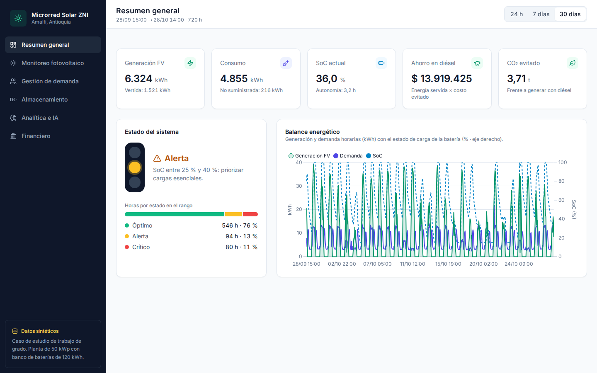

# Microrred Solar ZNI — Amalfi, Antioquia

Dashboard web en Django para el monitoreo, la gestión de demanda, el almacenamiento, la
analítica predictiva y la evaluación financiera de una microrred solar fotovoltaica comunitaria
(50 kWp, banco de baterías de 120 kWh) en una Zona No Interconectada de Amalfi, Antioquia.
Caso de estudio de trabajo de grado.

> **Datos sintéticos.** En esta fase (MVP) todos los datos salen de un generador físicamente
> coherente (`seed_amalfi_data`), no de sensores reales. Ver
> [ADR-0001](docs/adr/ADR-0001-mvp-con-datos-sinteticos.md).



## Puesta en marcha

Requisito: [uv](https://docs.astral.sh/uv/getting-started/installation/). uv instala la
versión de Python del proyecto (3.13) si no está.

```bash
uv sync
cd proyecto_energia
uv run python manage.py migrate
uv run python manage.py seed_amalfi_data
uv run python manage.py runserver
```

Abre <http://127.0.0.1:8000/>. El dashboard tiene seis pestañas (Resumen general, Monitoreo
fotovoltaico, Gestión de demanda, Almacenamiento, Analítica e IA, Financiero) y un selector de
rango (24 h, 7 días, 30 días). **Funciona sin internet**: Tailwind, Alpine.js, Chart.js, Lucide e
Inter se sirven desde `monitoreo/static/vendor/`, con versión, origen, SHA-256 y licencia en su
`MANIFIESTO.json` ([ADR-0003](docs/adr/ADR-0003-frontend-sin-internet.md)).

Para revisar los datos en el admin de Django (`/admin/`): `uv run python manage.py createsuperuser`.

## Datos y supuestos

`seed_amalfi_data` borra y regenera, en una transacción, 30 días de datos horarios (720 horas que
terminan en `--hasta`), sus segmentos de demanda, predicciones y anomalías, el resumen financiero
y el flujo de caja a 25 años.

- **Opciones:** `--dias` (mínimo 14, por defecto 30), `--semilla` (por defecto 42) y `--hasta`
  (última hora de la ventana, ISO 8601: `2026-10-28T14:00`, o con zona `…-05:00`; sin zona es hora
  de Bogotá; por defecto `FECHA_FIN_DEFAULT`).
- **Supuestos editables:** todos los parámetros financieros, ambientales y de la planta están
  documentados en la cabecera de
  [`seed_amalfi_data.py`](proyecto_energia/monitoreo/management/commands/seed_amalfi_data.py).
  Si cambia un supuesto, se edita ahí y se vuelve a ejecutar el comando; la API y el dashboard
  leen esos mismos valores. Las pruebas avisan si la TIR sale del rango 14–15 %.
- **Reproducibilidad:** sin argumentos, el comando genera **siempre** la misma ventana
  (2026-09-28 15:00 → 2026-10-28 14:00) y las mismas cifras, sea cual sea el día en que se
  ejecute: 546 / 94 / 80 h en estado óptimo / alerta / crítico; 6 324 kWh generados, 4 855
  demandados, 1 521 vertidos, 216 no suministrados; 8 anomalías; TIR 14,49 %. Una prueba lo
  exige: si cambia un supuesto a propósito, avisa que el documento escrito también debe cambiar.

## API

`GET /api/dashboard-data/?dias=1|7|30` (por defecto 7) o
`?desde=AAAA-MM-DD&hasta=AAAA-MM-DD` (días completos en hora de Bogotá). Devuelve en un solo
JSON los KPIs, las series horarias, el desglose por segmento, las métricas y anomalías y el
bloque financiero. El rango por días se cuenta desde el **último registro** de la base, no desde
la hora actual. Parámetros inválidos → `400` con `{"error": "…"}`. Contrato completo en
[OT-0005](ordenes-de-trabajo/feat/OT-0005-api-dashboard-data.md).

## Verificación

Desde la **raíz del repositorio** (si vienes de la puesta en marcha, `cd ..`):

```bash
./scripts/verify.sh
```

Corre ruff (lint y formato), `manage.py check`, `makemigrations --check` y las pruebas.

Verificación en navegador real (consola sin errores, 6 pestañas × 3 rangos, escritorio y móvil):

```bash
uv run playwright install chromium
uv run python scripts/verificar_consola.py
uv run python scripts/verificar_consola.py --offline
```

El script levanta su propio servidor (necesita la base sembrada) y termina con código 1 ante
cualquier error o aviso de consola, petición fallida, pestaña o rango faltante, gráfico sin
valores, valor vacío en pantalla («—», «NaN»), restos de plantilla sin renderizar o scroll
horizontal. **`--offline` bloquea toda petición que no sea al servidor local**: es la prueba de que
el dashboard funciona sin internet. El único aviso permitido es el del script de Tailwind («should
not be used in production»), aceptado para el MVP. Con `--control-negativo` inyecta errores a
propósito (y, con `--offline`, una petición externa) y **debe fallar**.

### Chromium sin sudo (WSL / Linux)

Si Chromium no arranca por librerías faltantes (`libnspr4.so`, `libnss3.so`…), lo normal es
`sudo uv run playwright install-deps chromium`. Sin `sudo`, se pueden extraer los paquetes en
una carpeta del usuario; `verificar_consola.py` la usa sola si existe (en Ubuntu 22.04 el
paquete de sonido se llama `libasound2` en vez de `libasound2t64`):

```bash
mkdir -p ~/.cache/sun-ia-chromium-deps/debs && cd ~/.cache/sun-ia-chromium-deps/debs && apt-get download libnspr4 libnss3 libasound2t64 && for f in *.deb; do dpkg-deb -x "$f" ../root; done
```

## Estructura

```text
sun_ia/
├── proyecto_energia/          proyecto Django (manage.py)
│   ├── monitoreo/             registros horarios, segmentos, simulación, seeder, API y dashboard
│   ├── analitica/             predicciones mock, detector de anomalías y métricas
│   └── financiero/            resumen y flujo de caja; VPN, TIR, LCOE y payback
├── scripts/                   verify.sh y verificar_consola.py
├── docs/adr/                  decisiones de arquitectura
├── docs/capturas/             capturas del dashboard
└── ordenes-de-trabajo/        plan y bitácora del trabajo (una OT por parte)
```

## Cómo se trabaja

El proyecto se construye por **órdenes de trabajo**: cada parte se diseña, se ejecuta por fases,
se valida y se registra con su evidencia. Índice y reglas en
[ordenes-de-trabajo/00-README.md](ordenes-de-trabajo/00-README.md); reglas del producto en
[CLAUDE.md](CLAUDE.md).
